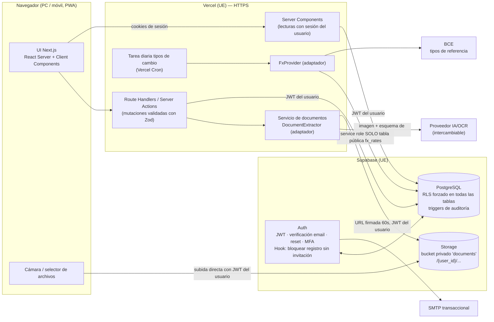
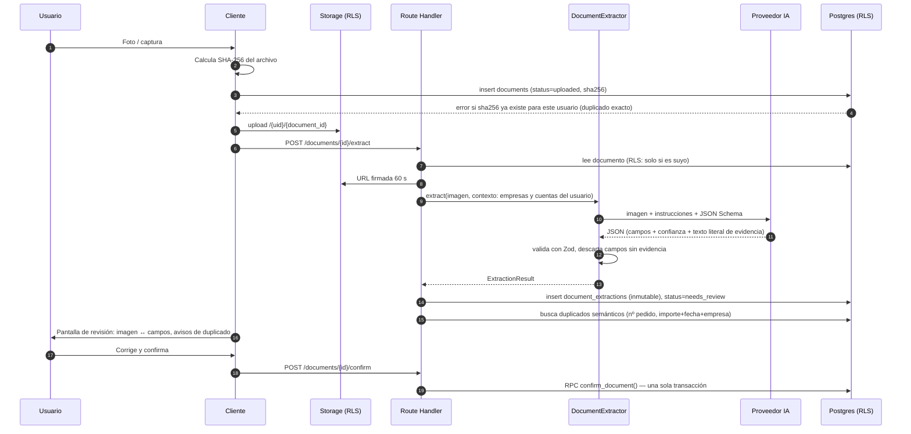

# 01 — Arquitectura técnica

## 1. Necesidades que dirigen la elección

| Necesidad | Consecuencia técnica |
|-----------|----------------------|
| Privacidad absoluta entre usuarios **aplicada en la base de datos** | Necesitamos un motor con Row Level Security real → PostgreSQL |
| Autenticación email+contraseña, verificación, recuperación, invitaciones | Proveedor de Auth gestionado que emita JWT entendidos por la BD |
| Archivos privados (capturas, facturas) aislados por usuario | Almacenamiento de objetos con políticas ligadas a la identidad del JWT |
| Datos financieros relacionales (cuentas ↔ compras ↔ payouts ↔ operaciones), agregados y filtros | SQL relacional con transacciones ACID, `numeric`, claves foráneas compuestas |
| OCR/IA con claves privadas | Código de servidor (nunca en el navegador) |
| Uso diario desde PC y móvil, sin servidores locales | Hosting gestionado con HTTPS, responsive, instalable como PWA |
| 3 usuarios iniciales, crecimiento moderado | No hace falta microservicios ni Kubernetes; sí migraciones versionadas y pruebas |
| Mantenible durante años por un equipo pequeño | Un solo lenguaje (TypeScript) de punta a punta, tipos generados desde el esquema |

## 2. Stack recomendado

| Capa | Elección | Por qué |
|------|----------|---------|
| Base de datos | **PostgreSQL (Supabase)** | RLS nativo, `numeric`, triggers, CHECK, FKs compuestas, vistas `security_invoker`, pgTAP para probar políticas |
| Auth | **Supabase Auth** | JWT cuyo `sub` usa directamente `auth.uid()` en las políticas RLS; verificación de email, reset de contraseña PKCE, MFA TOTP opcional, Auth Hooks para bloquear registros sin invitación |
| Archivos | **Supabase Storage (bucket privado)** | Las políticas se escriben en SQL sobre `storage.objects` con la misma identidad que la BD; URLs firmadas de corta duración |
| Frontend + servidor | **Next.js (App Router) + TypeScript estricto** | Server Components y Route Handlers mantienen las claves en servidor; SSR con cookies de sesión (`@supabase/ssr`); un único despliegue |
| UI | **Tailwind CSS + shadcn/ui (Radix)** | Componentes accesibles, sin dependencia de un kit cerrado; tema oscuro violeta vía tokens |
| Gráficos | **Recharts** | Suficiente para series mensuales, barras por empresa y donuts; ligero |
| Tablas | **TanStack Table** | Ordenar, filtrar, paginar en servidor |
| Formularios/validación | **React Hook Form + Zod** | Mismos esquemas Zod validan en cliente, en servidor y la salida de la IA |
| Dinero en TS | **decimal.js** (o enteros en minor units) | Nunca `number` para sumar importes |
| OCR/IA | **Adaptador `DocumentExtractor`**. Proveedor: **sin elegir (D3 pendiente)**; comparativa en el doc 11 §3 | Ver §5. Intercambiable sin tocar el resto |
| Tipos de cambio | **Adaptador `FxProvider`**; inicial: tipos de referencia del BCE | Gratuito, oficial, diario |
| Hosting web | **Vercel** (región UE, `fra1`) | Integración nativa con Next.js, HTTPS, previews por rama |
| Hosting datos | **Supabase Cloud, región UE (Frankfurt)** | Datos en la UE (RGPD) |
| Email transaccional | **SMTP propio (p. ej. Resend/Postmark)** | El SMTP por defecto de Supabase está fuertemente limitado y no sirve para producción |
| Migraciones | **Supabase CLI** (SQL versionado en git) | Revisables, reproducibles, nunca cambios a mano en producción |
| CI | **GitHub Actions** | Levanta Supabase local en el runner, ejecuta pgTAP + Vitest + Playwright |

> Las versiones exactas de cada librería se fijarán al inicio de la Fase 3, comprobando la documentación vigente.

## 3. Alternativas evaluadas y descartadas

| Alternativa | Motivo del descarte |
|-------------|---------------------|
| **Firebase / Firestore** | Reglas de seguridad no relacionales; agregados financieros y joins incómodos; sin `numeric` |
| **Backend propio (NestJS/Django) + Postgres autogestionado** | Más superficie que mantener (servidor, parches, backups, auth propia). Justificable con >10 desarrolladores, no aquí |
| **Seguridad solo en la capa API (sin RLS)** | Un único bug en un endpoint expone datos de otros. Tú pediste explícitamente que la privacidad no dependa del frontend; RLS da defensa en profundidad |
| **SPA pura (Vite) + Supabase** | Viable, pero OCR/IA y cualquier operación con claves exigiría funciones aparte. Next.js unifica |
| **Supabase Edge Functions para todo el servidor** | Se usarán solo si hace falta (p. ej. tareas programadas). Route Handlers de Next.js bastan y simplifican |
| **App móvil nativa** | Coste ×2. Una PWA responsive con captura de cámara cubre el caso de uso |
| **Cifrado de extremo a extremo de todos los datos** | Impediría estadísticas en SQL y OCR en servidor. Ver doc 03 §7 para el análisis completo |

## 4. Diagrama de componentes



**Regla de oro del diagrama:** todas las flechas hacia `PG` y `ST` que tocan datos privados viajan con el
**JWT del propio usuario**, por lo que RLS se aplica siempre. La clave `service_role` (que salta RLS) solo se usa
en dos puntos acotados y auditados: escribir la tabla pública `fx_rates` y, si se elige la variante B del doc 04,
crear el usuario al aceptar una invitación. Nunca para leer datos financieros.

## 5. Arquitectura del subsistema de OCR/IA



Interfaz (TypeScript, orientativa):

```ts
interface DocumentExtractor {
  readonly providerId: string;        // "anthropic", "google-docai", "aws-textract", "mock"
  readonly modelVersion: string;
  extract(input: { bytes: Uint8Array; mimeType: string; hints: ExtractionHints }): Promise<ExtractionResult>;
}

type ExtractedField<T> = { value: T | null; confidence: number; evidence: string | null };
```

Reglas del extractor:
- Si un dato no aparece literalmente en la imagen, el proveedor debe devolver `null`; un campo sin `evidence` se descarta.
- La IA **propone**; nunca escribe en tablas financieras. Solo `confirm_document()` (tras acción del usuario) lo hace.
- Se guarda proveedor, modelo y versión del prompt en cada extracción para poder auditar y comparar proveedores.
- Existe un `MockExtractor` determinista para pruebas: las pruebas nunca envían imágenes reales a un proveedor.

## 6. Despliegue y entornos

**Repositorio:** privado e independiente, `proppilot` (D1 aprobada). No comparte código, CI ni secretos con FitPro ni con TradePilot R.
La documentación de esta carpeta se moverá allí cuando se cree el repositorio.


| Entorno | Web | Base de datos | Uso |
|---------|-----|---------------|-----|
| Local/CI | `next dev` en el runner | Supabase local (Docker en el runner de CI) | Pruebas automáticas con datos sintéticos |
| Preview | Vercel preview por PR | Proyecto Supabase **staging** separado | Revisión visual, datos ficticios |
| Producción | Vercel producción en **dominio propio** (D9 aprobada), p. ej. `app.<dominio>`; correo desde el mismo dominio con SPF/DKIM/DMARC | Proyecto Supabase **producción** (Pro) | Uso real |

- Las migraciones se aplican a producción solo desde CI tras pasar todas las pruebas, y nunca son destructivas sin aprobación explícita.
- Secretos en variables de entorno de Vercel/GitHub; `.env*` en `.gitignore`; escaneo de secretos en CI.
- Solo `NEXT_PUBLIC_SUPABASE_URL` y la clave pública (anon/publishable) llegan al navegador; ambas son públicas por diseño y seguras **porque** RLS está activo.
- Cabeceras de seguridad: CSP estricta, `X-Frame-Options: DENY`, HSTS, `Referrer-Policy: strict-origin`.
- `robots: noindex` en toda la aplicación.

## 7. Requisitos no funcionales

| Requisito | Objetivo |
|-----------|----------|
| Disponibilidad | La de Vercel + Supabase (sin infraestructura propia) |
| Copias de seguridad | Diarias de Supabase Pro (D2 aprobada) + copia lógica propia cifrada de BD **y Storage** + ensayo de restauración trimestral (doc 11 §4) |
| Coste | ≈ 27–40 $/mes según escenario (doc 11 §2) |
| Rendimiento | Dashboard < 1,5 s con 10 000 operaciones por usuario (vistas agregadas + índices por `owner_id`) |
| Idioma / formato | Español; números `es-ES` (1.234,56 €); zona horaria `Europe/Madrid` para fechas contables |
| Accesibilidad | WCAG 2.1 AA en contraste (crítico en tema oscuro) |
