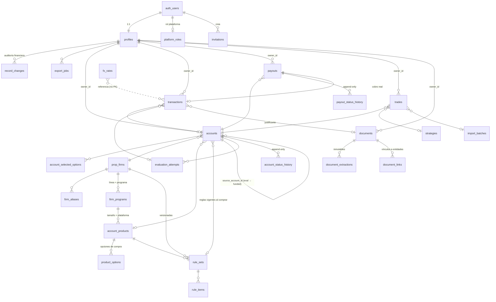
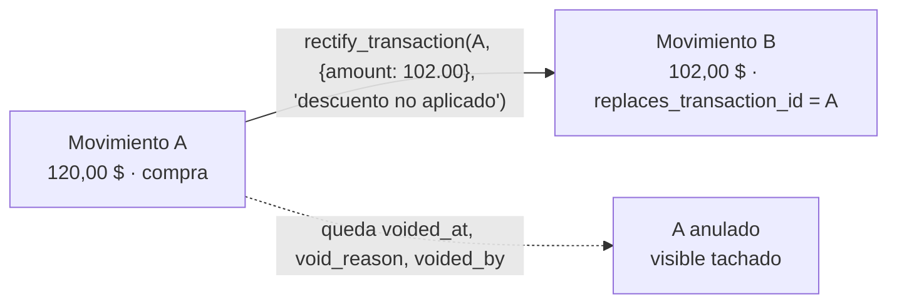

# 02 — Modelo de datos

> SQL de diseño orientativo. Se convertirá en migraciones versionadas y probadas en la Fase 3.

## 1. Conceptos clave (para no duplicar indicadores)

PropPilot separa cuatro cosas que en la vida real se confunden:

| Concepto | Qué es | Tabla |
|----------|--------|-------|
| **Movimiento de dinero** | Cualquier euro/dólar que sale o entra de tu bolsillo (compra, reset, activación, renovación, reembolso, payout cobrado, comisión, gasto). **Única fuente de verdad financiera.** | `transactions` |
| **Cuenta** | Una cuenta de trading con identidad propia en la empresa (de evaluación o funded) | `accounts` |
| **Intento de evaluación** | Cada intento de superar una evaluación en una cuenta (un reset abre un nuevo intento) | `evaluation_attempts` |
| **Payout** | El ciclo de vida de una retirada (solicitado → aprobado → pagado/rechazado). Cuando se cobra, genera **un** movimiento | `payouts` |

Consecuencias:
- *Cuentas compradas* = movimientos de tipo `purchase` (no filas de `accounts`, porque una cuenta funded nacida de una evaluación no se compra).
- *Tasa de superación* se mide sobre `evaluation_attempts`, no sobre cuentas.
- *Dinero cobrado* se suma desde `transactions`, nunca desde `payouts` → imposible contar un payout dos veces.

## 2. Diagrama entidad-relación



## 3. Convenciones globales

- Claves primarias `uuid` (`gen_random_uuid()`), sin IDs secuenciales enumerables.
- Toda tabla privada: `owner_id uuid not null default auth.uid() references auth.users(id)`.
- Toda tabla privada: `unique (id, owner_id)` para permitir **FKs compuestas** (ver §6).
- `created_at`, `updated_at timestamptz` en todas; `updated_at` por trigger.
- Dinero: `numeric(18,2)` para importes; `numeric(18,8)` para tipos de cambio; `numeric(20,8)` para precios/cantidades de trading.
- Divisas: `char(3)` ISO 4217 con CHECK contra una tabla `currencies`.
- Fechas contables: `date` (día en Europe/Madrid). Instantes: `timestamptz`.
- Estados: tipos `enum` de Postgres (añadir valores es no destructivo).
- Sin `DELETE` físico en datos contables: `voided_at`, `void_reason`; los registros anulados no cuentan en estadísticas.
- `archived_at` para ocultar entidades no contables sin perder historial.
- Cambios en datos económicos solo mediante RPC con motivo obligatorio, auditados en `record_changes` (§4.10).

## 4. Tablas

### 4.1 Identidad y acceso

```sql
create table profiles (
  id            uuid primary key references auth.users(id) on delete cascade,
  display_name  text not null check (length(display_name) between 1 and 80),
  base_currency char(3) not null default 'EUR',
  timezone      text not null default 'Europe/Madrid',
  created_at    timestamptz not null default now(),
  updated_at    timestamptz not null default now()
);

-- Separado de profiles para que nadie pueda auto-escalarse editando su perfil.
create table platform_roles (
  user_id    uuid primary key references auth.users(id) on delete cascade,
  role       text not null check (role in ('platform_owner')),
  granted_at timestamptz not null default now()
);  -- sin políticas de escritura: solo se modifica por migración/consola

create table invitations (            -- detalle en doc 04
  id            uuid primary key default gen_random_uuid(),
  created_by    uuid not null references auth.users(id),
  token_hash    bytea not null unique,          -- SHA-256 del token; el token nunca se guarda
  invitee_email citext,                         -- opcional pero recomendado (vincula la invitación)
  invitee_name  text,
  status        invitation_status not null default 'pending', -- pending|accepted|revoked|expired
  expires_at    timestamptz not null,
  accepted_by   uuid references auth.users(id),
  accepted_at   timestamptz,
  revoked_at    timestamptz,
  created_at    timestamptz not null default now(),
  check (expires_at > created_at)
);
```

### 4.2 Catálogo de empresas y reglas versionadas

```sql
create table prop_firms (
  id            uuid primary key default gen_random_uuid(),
  scope         firm_scope not null,                 -- 'global' | 'private'
  owner_id      uuid references auth.users(id),      -- null si global; obligatorio si private
  name          text not null,
  slug          text not null,
  country       char(2),
  base_currency char(3) not null,
  logo_path     text,                                -- en bucket público 'firm-logos' (no es dato privado)
  website_url   text,
  dashboard_url text,
  rules_url     text,
  status        text not null default 'active' check (status in ('active','archived')),
  check ((scope = 'global' and owner_id is null) or (scope = 'private' and owner_id is not null))
);
create unique index on prop_firms (coalesce(owner_id, '00000000-0000-0000-0000-000000000000'), slug);

create table firm_aliases (            -- ayuda al OCR a identificar la empresa ("NYS", "NYSMarkets"...)
  firm_id uuid references prop_firms(id), alias text not null, primary key (firm_id, alias)
);

create table firm_programs (           -- "LucidFlex", "LucidPro", "NYS Futures · The Thunder", "NYS CFDs · One Trade"
  id            uuid primary key default gen_random_uuid(),
  firm_id       uuid not null references prop_firms(id),
  business_line text not null,          -- 'futures' | 'cfd' | 'forex' | 'crypto' (NYS tiene CFDs y futuros)
  name          text not null,
  program_type  program_type not null,  -- evaluation_1step|evaluation_2step|instant_funded|direct_funded|other
  access        text not null default 'public' check (access in ('public','invite_only','legacy')),
  unique (firm_id, business_line, name)
);

create table account_products (        -- programa × tamaño × variante de plataforma: "LucidFlex 25K Rithmic"
  id               uuid primary key default gen_random_uuid(),
  firm_id          uuid not null references prop_firms(id),
  program_id       uuid not null references firm_programs(id),
  product_kind     text not null check (product_kind in ('account','reset','activation','add_on','subscription')),
  name             text not null,
  nominal_size     numeric(18,2) check (nominal_size > 0),
  currency         char(3) not null,
  platform_variant text,                 -- 'Rithmic', 'NT/TDV', 'MT5'... (puede cambiar reglas y precio)
  list_price       numeric(18,2),        -- null = no verificado
  price_verification rule_verification not null default 'pending',
  price_source_url text,
  price_checked_on date,
  billing          text check (billing in ('one_time','monthly','unknown')),
  status           text not null default 'active'
);

create table product_options (         -- opciones elegidas en la compra que alteran reglas
  id          uuid primary key default gen_random_uuid(),
  product_id  uuid not null references account_products(id),
  option_key  text not null,           -- 'daily_loss_limit' | 'consistency_addon' ...
  option_value text not null,          -- 'none' | 'fixed' | '50pct' ...
  extra_price numeric(18,2),
  verification_status rule_verification not null default 'pending',
  source_url  text
);

create type rule_verification as enum ('pending','candidate','verified','outdated','disputed');  -- ver doc 10 §1

create table rule_sets (                -- una versión de las reglas de un producto
  id                  uuid primary key default gen_random_uuid(),
  firm_id             uuid not null references prop_firms(id),
  product_id          uuid references account_products(id),  -- null SOLO para reglas con rule_keys.firm_scope_allowed
  option_filter       jsonb,             -- p. ej. {"daily_loss_limit":"fixed"}: solo aplica a cuentas con esa opción
  version             int not null,
  effective_from      date,
  effective_to        date,
  applies_to_purchases_from timestamptz, -- p. ej. LucidPro: condiciones distintas antes/después del 28/11/2025 15:00 EST
  applies_to_purchases_to   timestamptz,
  verification_status rule_verification not null default 'pending',
  source_url          text,
  source_document_id  uuid,              -- captura de la web de reglas, si se guardó
  last_reviewed_at    timestamptz,
  reviewed_by         uuid references auth.users(id),
  notes               text,
  unique (firm_id, product_id, version)
);

create table rule_items (               -- cada regla individual, tipada y verificable
  id                  uuid primary key default gen_random_uuid(),
  rule_set_id         uuid not null references rule_sets(id),
  phase               rule_phase not null,     -- evaluation|funded|payout|general
  rule_key            text not null references rule_keys(key),
  value_numeric       numeric,
  value_text          text,
  unit                text,                    -- 'USD','percent_of_initial_balance','percent_of_cycle_profit','days','contracts'...
  verification_status rule_verification not null default 'pending',
  source_url          text,                    -- obligatoria salvo en 'pending'
  source_accessed_on  date,                    -- fecha de consulta (obligatoria salvo en 'pending')
  source_excerpt      text,                    -- texto literal de la fuente
  source_document_id  uuid,                    -- captura de la página (obligatoria para 'verified')
  verified_by         uuid references auth.users(id),
  notes               text,
  check (verification_status = 'pending' or (source_url is not null and source_accessed_on is not null)),
  check (verification_status <> 'verified' or (source_document_id is not null and verified_by is not null))
);

create table account_selected_options (   -- qué opciones eligió el usuario al comprar (filtra reglas)
  account_id uuid not null, owner_id uuid not null,
  option_id  uuid not null references product_options(id),
  primary key (account_id, option_id),
  foreign key (account_id, owner_id) references accounts(id, owner_id)
);
```

**Resolución de reglas de una cuenta:** se toman las reglas de los `rule_sets` cuyo `product_id` es el de la cuenta,
cuya ventana `applies_to_purchases_*` contiene la fecha de compra (o del último reset) y cuyo `option_filter` coincide con las
opciones elegidas, más las reglas de empresa de claves con `firm_scope_allowed`. **No hay herencia entre programas, tamaños,
variantes de plataforma ni líneas de negocio.** Solo las reglas `verified` alimentan cálculos y alertas.

`rule_keys` es un catálogo extensible (sin tocar código) con claves como: `profit_target`, `max_drawdown`,
`drawdown_type` (trailing/EOD/static), `daily_loss_limit`, `min_trading_days`, `min_winning_days`,
`winning_day_threshold`, `consistency_rule_pct`, `max_contracts`, `profit_split_pct`, `payout_min_amount`,
`payout_max_amount`, `payout_frequency_days`, `payout_buffer`, `activation_fee`, `reset_fee`,
`renewal_fee`, `renewal_period_days`, `news_trading_allowed`, `overnight_allowed`...

Una regla nunca se edita "en sitio" si cambia de valor: se crea una nueva versión de `rule_set`.
**Ninguna regla de NYS Markets ni de Lucid Trading se carga como `verified` sin fuente oficial revisada por ti.**

### 4.3 Cuentas

```sql
create type account_phase  as enum ('evaluation','funded');
create type account_status as enum (
  'purchased','evaluation_active','evaluation_passed','funded_active',
  'burned','closed','refunded'
);   -- 'payout pendiente/recibido' se derivan de payouts (ver decisión D10)

create table accounts (
  id                  uuid primary key default gen_random_uuid(),
  owner_id            uuid not null default auth.uid() references auth.users(id),
  firm_id             uuid not null references prop_firms(id),
  product_id          uuid references account_products(id),
  rule_set_id         uuid references rule_sets(id),     -- versión vigente al comprar/activar
  phase               account_phase not null,
  status              account_status not null,
  source_account_id   uuid,                              -- evaluación de la que procede (si funded)
  label               text,                              -- nombre amigable "Lucid 50K #3"
  external_account_id text,                              -- ID en la empresa/plataforma
  platform            text,
  nominal_size        numeric(18,2) not null check (nominal_size > 0),
  currency            char(3) not null,
  opened_on           date not null,
  closed_on           date,
  notes               text,
  archived_at         timestamptz,
  unique (id, owner_id),
  foreign key (source_account_id, owner_id) references accounts(id, owner_id)
);
create unique index on accounts (owner_id, firm_id, external_account_id) where external_account_id is not null;

create table evaluation_attempts (
  id           uuid primary key default gen_random_uuid(),
  owner_id     uuid not null default auth.uid(),
  account_id   uuid not null,
  attempt_no   int  not null check (attempt_no >= 1),
  started_on   date not null,
  ended_on     date,
  outcome      attempt_outcome not null default 'ongoing', -- ongoing|passed|failed|abandoned
  reason       text,
  unique (id, owner_id),
  unique (account_id, attempt_no),
  foreign key (account_id, owner_id) references accounts(id, owner_id)
);

create table account_status_history (   -- append-only
  id           bigint generated always as identity primary key,
  owner_id     uuid not null default auth.uid(),
  account_id   uuid not null,
  from_status  account_status,
  to_status    account_status not null,
  changed_at   timestamptz not null default now(),
  effective_on date not null,             -- fecha real del suceso (puede ser anterior al registro)
  changed_by   uuid not null default auth.uid(),
  reason       text,
  document_id  uuid,
  foreign key (account_id, owner_id) references accounts(id, owner_id),
  foreign key (document_id, owner_id) references documents(id, owner_id)
);
```

**Mecanismo de cambio de estado:** el usuario **inserta** en `account_status_history`; un trigger valida la
transición contra la máquina de estados (doc 05 §2) y actualiza `accounts.status`. La columna
`accounts.status` no es actualizable directamente por el rol `authenticated` (privilegio de columna revocado).
Así no existe ningún cambio de estado sin fila de historial.

### 4.4 Libro de movimientos (ledger)

```sql
create type txn_kind as enum (
  'purchase','reset_fee','activation_fee','renewal_fee',       -- coste de cuentas
  'data_fee','platform_fee','tool_subscription','other_expense', -- otros gastos
  'refund',                                                     -- devuelve dinero de un coste
  'payout_receipt',                                             -- cobro real de payout
  'bank_fee','other_income'
);

create table transactions (
  id              uuid primary key default gen_random_uuid(),
  owner_id        uuid not null default auth.uid(),
  kind            txn_kind not null,
  direction       smallint not null check (direction in (-1, 1)),   -- -1 sale, +1 entra
  status          txn_status not null default 'settled',            -- pending|settled
  occurred_on     date not null,
  firm_id         uuid references prop_firms(id),
  account_id      uuid,
  attempt_id      uuid,
  payout_id       uuid,
  -- importe original (inmutable tras confirmar)
  amount          numeric(18,2) not null check (amount > 0),
  currency        char(3) not null,
  -- desglose de compra
  list_price      numeric(18,2),
  discount_amount numeric(18,2) check (discount_amount >= 0),
  discount_code   text,
  -- conversión a EUR (instantánea en el momento del registro)
  fx_rate         numeric(18,8) not null,           -- EUR por 1 unidad de `currency` (1 si EUR)
  fx_rate_date    date not null,
  fx_source       fx_source not null,               -- 'identity'|'ecb'|'actual_bank'|'manual'
  amount_eur      numeric(18,2) not null,
  payment_method  text,
  description     text,
  document_id     uuid,
  document_item_key text,                           -- qué elemento del documento originó este movimiento ('total', 'line:2')
  external_ref_type text check (external_ref_type in ('invoice','order','payment','payout','other')),
  external_ref    text,                             -- nº de factura/pedido/transacción tal como aparece
  dedupe_key      text,                             -- normalizado: firm_id + tipo ref + ref en mayúsculas sin espacios/guiones
  fingerprint     text,                             -- hash(firm_id, kind, amount, currency, occurred_on) para avisos difusos
  duplicate_override_reason text,                   -- obligatorio si el usuario confirma pese a un aviso de posible duplicado
  -- rectificación y anulación trazables (ver §4.10)
  voided_at       timestamptz,
  voided_by       uuid,
  void_reason     text,
  replaces_transaction_id uuid,                     -- esta fila rectifica a otra (que queda anulada)
  unique (id, owner_id),
  foreign key (replaces_transaction_id, owner_id) references transactions(id, owner_id),
  check ((voided_at is null) = (void_reason is null)),
  foreign key (account_id, owner_id) references accounts(id, owner_id),
  foreign key (attempt_id, owner_id) references evaluation_attempts(id, owner_id),
  foreign key (payout_id,  owner_id) references payouts(id, owner_id),
  foreign key (document_id, owner_id) references documents(id, owner_id),
  check (fx_source <> 'identity' or (currency = 'EUR' and fx_rate = 1)),
  check (kind not in ('refund','payout_receipt','other_income') or direction = 1),
  check (kind in ('refund','payout_receipt','other_income') or direction = -1),
  check (kind <> 'payout_receipt' or payout_id is not null)
);
create unique index on transactions (owner_id, kind, dedupe_key) where dedupe_key is not null and voided_at is null;
create unique index on transactions (payout_id) where kind = 'payout_receipt' and voided_at is null;  -- 1 cobro por payout
create unique index on transactions (owner_id, document_id, document_item_key)
  where document_id is not null and voided_at is null;   -- un mismo elemento de un justificante no genera 2 movimientos
create unique index on transactions (replaces_transaction_id) where replaces_transaction_id is not null; -- 1 rectificación por fila
```

Inmutabilidad de importes: una vez creado el movimiento, `amount`, `currency`, `kind`, `direction`, `occurred_on`, `fx_*` y `amount_eur`
**no se pueden actualizar** (privilegio de columna + trigger). Para corregirlos se **rectifica**: el movimiento original se anula y se crea uno
nuevo con `replaces_transaction_id`, todo en una transacción mediante la RPC `rectify_transaction` (ver §4.10). Ambos quedan visibles.

### 4.5 Payouts

```sql
create type payout_status as enum ('requested','approved','rejected','paid','cancelled');

create table payouts (
  id                 uuid primary key default gen_random_uuid(),
  owner_id           uuid not null default auth.uid(),
  account_id         uuid not null,
  firm_id            uuid not null references prop_firms(id),
  status             payout_status not null default 'requested',
  requested_on       date not null,
  requested_amount   numeric(18,2) not null check (requested_amount > 0),
  currency           char(3) not null,
  approved_on        date,
  approved_amount    numeric(18,2),
  rejected_on        date,
  rejection_reason   text,
  paid_on            date,                         -- fecha de recepción
  -- el importe recibido, comisiones y EUR finales viven en la transaction payout_receipt
  method             text,                         -- Rise, transferencia, cripto...
  notes              text,
  unique (id, owner_id),
  foreign key (account_id, owner_id) references accounts(id, owner_id),
  check (status <> 'paid' or paid_on is not null)
);

create table payout_status_history ( /* análoga a account_status_history */ );
```

Al pasar a `paid`, la RPC `register_payout_received()` crea en la **misma transacción SQL** el movimiento
`payout_receipt` con: importe efectivamente recibido, divisa recibida, comisiones (como `bank_fee` separado
o neto, ver doc 06), tipo de cambio y EUR final.

### 4.6 Operaciones

```sql
create table instruments (              -- catálogo editable por el usuario (o global)
  id uuid primary key default gen_random_uuid(),
  owner_id uuid,                         -- null = global
  symbol text not null,                  -- NQ, MNQ, ES, EURUSD...
  asset_class text,
  point_value numeric(20,8),             -- valor monetario de 1 punto por contrato/lote
  tick_size numeric(20,8),
  currency char(3) not null
);

create table strategies (id uuid primary key default gen_random_uuid(), owner_id uuid not null default auth.uid(),
  name text not null, description text, archived_at timestamptz, unique (id, owner_id), unique (owner_id, name));

create table trades (
  id                uuid primary key default gen_random_uuid(),
  owner_id          uuid not null default auth.uid(),
  account_id        uuid not null,
  instrument_id     uuid references instruments(id),
  symbol            text not null,
  direction         text not null check (direction in ('long','short')),
  opened_at         timestamptz not null,
  closed_at         timestamptz,
  entry_price       numeric(20,8) not null,
  exit_price        numeric(20,8),
  stop_loss         numeric(20,8),
  take_profit       numeric(20,8),
  quantity          numeric(20,8) not null check (quantity > 0),
  commissions       numeric(18,2) not null default 0 check (commissions >= 0),
  gross_pnl         numeric(18,2),           -- en la divisa de la cuenta
  net_pnl           numeric(18,2) generated always as (gross_pnl - commissions) stored,
  initial_risk      numeric(18,2),           -- |entry - stop| * qty * point_value (calculado al guardar)
  r_multiple        numeric(10,4),           -- net_pnl / initial_risk; null sin stop
  strategy_id       uuid,
  chart_document_id uuid,
  notes             text,
  import_batch_id   uuid,
  external_trade_id text,                    -- ID de la plataforma, si existe
  trade_fingerprint text not null,           -- hash(account_id, symbol, direction, opened_at a segundo, closed_at, quantity, entry, exit)
  voided_at         timestamptz,             -- las operaciones también se anulan, no se borran
  void_reason       text,
  unique (id, owner_id),
  foreign key (account_id, owner_id)  references accounts(id, owner_id),
  foreign key (strategy_id, owner_id) references strategies(id, owner_id),
  check (closed_at is null or closed_at >= opened_at)
);
create unique index on trades (owner_id, account_id, external_trade_id) where external_trade_id is not null and voided_at is null;
create unique index on trades (owner_id, trade_fingerprint) where voided_at is null;  -- reimportar el mismo CSV no duplica

create table import_batches (
  id uuid primary key default gen_random_uuid(), owner_id uuid not null default auth.uid(),
  source text not null,                      -- 'csv:tradovate', 'csv:rithmic', 'screenshot'...
  file_document_id uuid,                     -- el CSV original queda en el centro de documentos (dedupe por sha256)
  rows_total int, rows_imported int, rows_skipped_duplicate int, rows_rejected int,
  status text not null check (status in ('preview','imported','reverted')),
  reverted_at timestamptz, revert_reason text,
  unique (id, owner_id)
);
```

El P&L de trading está en la divisa de la cuenta y **es capital nominal de la empresa, no tu dinero**. Por eso
`trades` no tiene conversión a EUR ni entra en las finanzas reales (doc 06).

### 4.7 Documentos

```sql
create table documents (
  id             uuid primary key default gen_random_uuid(),
  owner_id       uuid not null default auth.uid(),
  storage_path   text not null unique,       -- '{owner_id}/{id}.{ext}' (CHECK de prefijo)
  original_name  text,
  mime_type      text not null check (mime_type in ('image/jpeg','image/png','image/webp','image/heic','application/pdf','text/csv')),
  size_bytes     int not null check (size_bytes <= 15 * 1024 * 1024),
  sha256         bytea not null,
  perceptual_hash bigint,                    -- detección de casi-duplicados (misma captura recomprimida)
  doc_type       doc_type,                   -- purchase_receipt|invoice|payment_confirmation|evaluation_passed|
                                             -- funded_confirmation|account_burned|trade_history|payout_receipt|rules|other
  status         doc_status not null default 'uploaded', -- uploaded|processing|needs_review|confirmed|rejected|failed
  firm_id        uuid references prop_firms(id),
  confirmed_at   timestamptz,
  unique (id, owner_id),
  unique (owner_id, sha256),
  check (storage_path like owner_id::text || '/%')
);

create table document_extractions (         -- inmutable: cada ejecución de OCR/IA queda guardada
  id             uuid primary key default gen_random_uuid(),
  owner_id       uuid not null default auth.uid(),
  document_id    uuid not null,
  provider       text not null,
  model          text not null,
  prompt_version text not null,
  result         jsonb not null,             -- campos + confianza + evidencia
  error          text,
  created_at     timestamptz not null default now(),
  foreign key (document_id, owner_id) references documents(id, owner_id)
);

create table document_links (               -- un documento puede justificar varias entidades
  document_id uuid not null, owner_id uuid not null,
  entity_type text not null check (entity_type in ('account','transaction','payout','trade','status_change')),
  entity_id   uuid not null,
  primary key (document_id, entity_type, entity_id),
  foreign key (document_id, owner_id) references documents(id, owner_id)
);
```

### 4.8 Tablas de referencia públicas (sin datos privados)

```sql
create table currencies (code char(3) primary key, name text, decimals smallint);
create table fx_rates (
  rate_date date not null, base char(3) not null default 'EUR', quote char(3) not null,
  rate numeric(18,8) not null check (rate > 0),   -- 1 EUR = rate unidades de quote (convenio BCE)
  source text not null default 'ecb', fetched_at timestamptz not null default now(),
  primary key (rate_date, base, quote, source)
);
```

### 4.9 Auditoría de acciones sensibles

```sql
create table audit_log (                    -- acciones: invitaciones, exportaciones, inicios de sesión, baja de cuenta
  id bigint generated always as identity primary key,
  actor_id uuid, owner_id uuid, action text not null, entity_type text, entity_id uuid,
  details jsonb, created_at timestamptz not null default now()
);  -- insert solo vía triggers/funciones SECURITY DEFINER; select solo de las propias filas; sin update/delete
```

### 4.10 Auditoría financiera de cambios (mejora obligatoria 1)

Toda creación, modificación, anulación y rectificación de **compras y gastos** (`transactions`), **payouts**, **operaciones** (`trades`)
y **datos económicos de cuentas** (`accounts`: precio, producto, tamaño, fechas) queda registrada campo a campo.

```sql
create table record_changes (               -- append-only
  id            bigint generated always as identity primary key,
  owner_id      uuid not null,               -- dueño del registro afectado (para RLS)
  table_name    text not null,               -- 'transactions' | 'payouts' | 'trades' | 'accounts'
  record_id     uuid not null,               -- identificador del registro afectado
  operation     text not null check (operation in ('insert','update','void','rectify','revert_import','restore')),
  changed_by    uuid not null,               -- usuario que hizo el cambio (auth.uid())
  changed_at    timestamptz not null default now(),   -- fecha y hora
  old_values    jsonb,                       -- solo las columnas que cambian (null en insert)
  new_values    jsonb,                       -- solo las columnas que cambian
  reason        text not null check (length(trim(reason)) >= 3),  -- motivo obligatorio (en insert: 'alta', 'alta desde documento X')
  source        text not null check (source in ('form','document_review','csv_import','rpc','migration')),
  document_id   uuid,                        -- evidencia, si la hay
  related_record_id uuid,                    -- p. ej., la fila nueva que rectifica a la anulada
  client_request_id uuid                     -- idempotencia de la petición que originó el cambio
);
create index on record_changes (owner_id, table_name, record_id, changed_at);
```

**Cómo se garantiza que no hay cambios sin registro ni sin motivo:**

1. El rol `authenticated` **no tiene privilegio `UPDATE` directo** sobre las columnas económicas de estas tablas.
   Las modificaciones pasan por RPC (`update_transaction_metadata`, `rectify_transaction`, `void_transaction`, `update_payout`, `update_trade`, `void_trade`…),
   todas `SECURITY INVOKER` (RLS aplica), y todas exigen `p_reason`.
2. Cada RPC hace `set_config('proppilot.change_reason', p_reason, true)` (local a la transacción) antes de escribir.
3. Un trigger `AFTER INSERT OR UPDATE` en cada tabla auditada escribe en `record_changes` el diff OLD→NEW, `auth.uid()` y el motivo
   leído de `proppilot.change_reason`. **Si el motivo está vacío, el trigger lanza una excepción y la transacción entera se deshace.**
   Así, aunque en el futuro alguien añadiera un `UPDATE` directo por error, fallaría en vez de quedar sin auditar.
4. Sin política `DELETE` en ninguna tabla financiera, y un trigger `BEFORE DELETE` que lanza una excepción para cualquier rol de la aplicación.
5. `record_changes`: RLS `select` solo `owner_id = auth.uid()`; insert únicamente desde el trigger (`SECURITY DEFINER` en el esquema `private`);
   sin update/delete (trigger de rechazo).

**Rectificación y anulación trazables:**



- **Anular** (`void_transaction`): marca `voided_at`, `voided_by` y `void_reason`, y registra `operation = 'void'`. El registro sigue visible en el historial y deja de contar en los totales.
- **Rectificar** (`rectify_transaction`): en una sola transacción anula A y crea B con `replaces_transaction_id = A`. Registra `operation = 'rectify'` con `related_record_id = B`.
- **Metadatos no económicos** (descripción, método de pago, nota): se pueden editar con la RPC y motivo, y el diff queda registrado.
- **Payouts:** los importes aprobado y solicitado solo se corrigen por RPC con motivo. Si el payout ya está cobrado, la corrección del importe recibido rectifica el movimiento `payout_receipt`.
- **Operaciones:** la edición por RPC con motivo genera un diff. "Eliminar" una operación es en realidad anularla (`voided_at`). Revertir una importación anula todas las operaciones del lote con `operation = 'revert_import'`.
- La UI muestra en cada registro una pestaña **Historial de cambios** (quién, cuándo, antes → después, motivo, evidencia).

### 4.11 Exportaciones

```sql
create table export_jobs (
  id           uuid primary key default gen_random_uuid(),
  owner_id     uuid not null default auth.uid(),
  format       text not null check (format in ('csv','xlsx','zip_documents','full_archive')),
  scope        text[] not null,               -- {'transactions','accounts','trades','payouts','record_changes'}
  filters      jsonb,                         -- rango de fechas, empresa…
  status       text not null check (status in ('queued','running','ready','failed','expired')),
  storage_path text check (storage_path like owner_id::text || '/exports/%'),
  expires_at   timestamptz,                   -- el archivo generado se borra a las 24 h
  created_at   timestamptz not null default now(),
  unique (id, owner_id)
);
```

## 5. Divisas: reglas de almacenamiento

1. Siempre se guarda **importe original + divisa** (`amount`, `currency`).
2. Se guarda la **instantánea de conversión**: `fx_rate`, `fx_rate_date`, `fx_source`, `amount_eur`.
3. `amount_eur = round(amount × fx_rate, 2)` con redondeo bancario documentado (half-even) y probado.
4. Prioridad de fuente: `actual_bank` (lo que realmente llegó a tu banco en EUR) > `ecb` del día del suceso
   (o último día hábil anterior) > `manual`.
5. **Actualizar `fx_rates` nunca recalcula movimientos existentes.** Si se quiere revaluar, es una vista
   aparte ("valor a tipo actual") claramente etiquetada, nunca sobrescribe.
6. Los `fx_rates` del BCE se publican como "1 EUR = X USD"; la conversión USD→EUR es `1 / X`, y se almacena ya invertida en `transactions.fx_rate` para evitar ambigüedad.

## 6. Integridad entre propietarios (FKs compuestas)

RLS impide **leer** filas ajenas, pero por sí solo no impide que alguien que adivine un UUID ajeno lo
**referencie** (p. ej., crear una operación apuntando a la cuenta de otra persona). La defensa:

```sql
-- padre
alter table accounts add unique (id, owner_id);
-- hijo
foreign key (account_id, owner_id) references accounts(id, owner_id)
```

Como el `owner_id` del hijo está forzado a `auth.uid()` por la política `WITH CHECK`, la FK solo se satisface si
la cuenta padre también es del usuario. Esto se aplica a **todas** las relaciones entre tablas privadas.

## 7. Índices previstos

- `(owner_id, occurred_on)` en `transactions`; `(owner_id, kind, occurred_on)`.
- `(owner_id, status)` y `(owner_id, firm_id)` en `accounts`.
- `(owner_id, closed_at)` y `(owner_id, account_id)` en `trades`.
- `owner_id` como primera columna en prácticamente todos: las políticas RLS filtran por él.
