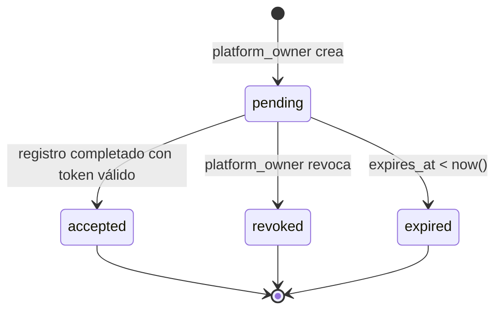
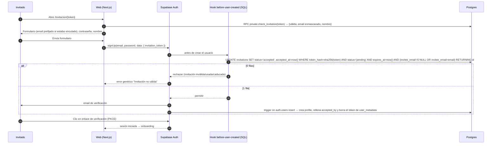

# 04 — Sistema de invitaciones y autenticación

## 1. Requisitos

- Sin registro público. Solo con invitación válida.
- Invitación individual, de **un solo uso**, con caducidad, revocable, con estado consultable.
- Compartible por WhatsApp.
- Cada invitado crea su cuenta con email + contraseña; email verificado.
- Recuperación de contraseña.

## 2. Arranque: el primer usuario

No se usa "el primero que se registra es el propietario" (condición de carrera: cualquiera que llegue antes a la URL
se convertiría en dueño). En su lugar:

1. Tras desplegar, tú creas tu usuario desde el panel de Supabase (o con un script de bootstrap de un solo uso en CI).
2. Una migración/semilla manual inserta tu `user_id` en `platform_roles` como `platform_owner`.
3. A partir de ahí, todos los demás usuarios entran por invitación.

## 3. Ciclo de vida

`expired` se calcula al consultar (`status='pending' and expires_at < now()`) y se materializa por una tarea periódica;
la validación **siempre** compara `expires_at` con `now()`, nunca confía en el estado guardado.

## 4. Generación y envío

1. El `platform_owner` abre "Invitar", indica nombre y (recomendado) email del invitado, y caducidad (por defecto 72 h, máx. 7 días).
2. El servidor genera un token de **256 bits** aleatorios criptográficos (`crypto.getRandomValues`), codificado base64url.
3. Se guarda **solo** `SHA-256(token)` en `invitations.token_hash`. El token en claro se muestra una única vez.
4. Se construye `https://<dominio>/invitacion/<token>` y el botón "Compartir por WhatsApp" abre
   `https://wa.me/?text=<mensaje codificado con el enlace>`. También botón "Copiar enlace".
5. Se registra en `audit_log`.

Por qué hash: si alguien obtuviera una copia de la tabla, no podría usar invitaciones pendientes.

## 5. Aceptación

Garantías:
- **Uso único y sin carreras:** el `UPDATE ... WHERE status='pending' ... RETURNING` es atómico. Dos registros simultáneos con el mismo token: solo uno obtiene la fila.
- **Vinculación al email:** si se indicó email, un tercero que reciba el enlace reenviado no puede usarlo con otro correo.
- **Sin enumeración:** respuestas de error genéricas e idénticas para "no existe", "usada", "caducada" y "revocada"; rate limit por IP en `/invitacion/*`.
- **Token fuera de los datos persistentes del usuario:** se elimina de `user_metadata` tras el alta.

### Variante B (si el hook no cubre algún caso en la versión vigente de Supabase)

Registro público desactivado en Supabase. Un Route Handler del servidor valida y consume la invitación y crea el
usuario con la API admin (`service_role`, único uso permitido), luego envía la verificación. Más código propio,
mismas garantías. **Se elegirá en Fase 3 tras comprobar la documentación actual de Supabase Auth Hooks.**

## 6. Verificación de email y SMTP

- "Confirm email" activado. Un usuario sin verificar no obtiene sesión.
- **Se necesita SMTP propio** (Resend, Postmark, Brevo…): el SMTP integrado de Supabase está limitado a unos pocos
  correos por hora y está pensado solo para pruebas. Requiere un dominio para enviar (decisión D9).
- Plantillas de email en español con la marca PropPilot.
- URLs de redirección permitidas: solo el dominio de producción y los de preview.

## 7. Recuperación de contraseña

- "¿Olvidaste tu contraseña?" → `resetPasswordForEmail` con flujo PKCE → enlace de un solo uso con caducidad corta → pantalla de nueva contraseña.
- Respuesta idéntica exista o no el email (sin enumeración de usuarios).
- Política de contraseñas: mínimo 12 caracteres; comprobación contra contraseñas filtradas si el plan lo permite.
- Al cambiar la contraseña se cierran las demás sesiones.

## 8. Administración de invitaciones (solo `platform_owner`)

Pantalla con: nombre, email, creada, caduca, estado, aceptada por/cuándo; acciones **Revocar** y **Reenviar** (reenviar = revocar + crear nueva, nunca reutilizar token).
La política RLS de `invitations` solo permite `select/insert/update(revoked_at,status)` a `created_by = auth.uid() and private.is_platform_owner()`.
Esta pantalla **no** muestra nada de la actividad del usuario una vez dentro.

## 9. Pruebas específicas (ver doc 07)

Token reutilizado · token caducado · token revocado · email distinto al vinculado · dos aceptaciones concurrentes ·
miembro intentando crear invitación · lectura de `invitations` por miembro · token en claro nunca presente en BD ni logs.
