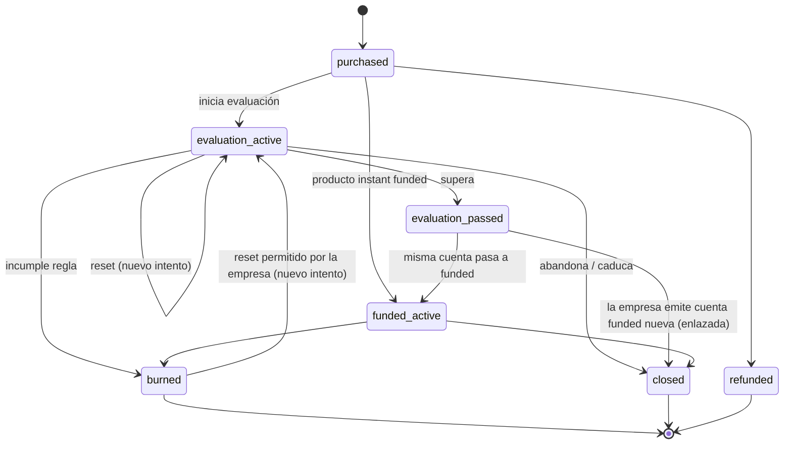
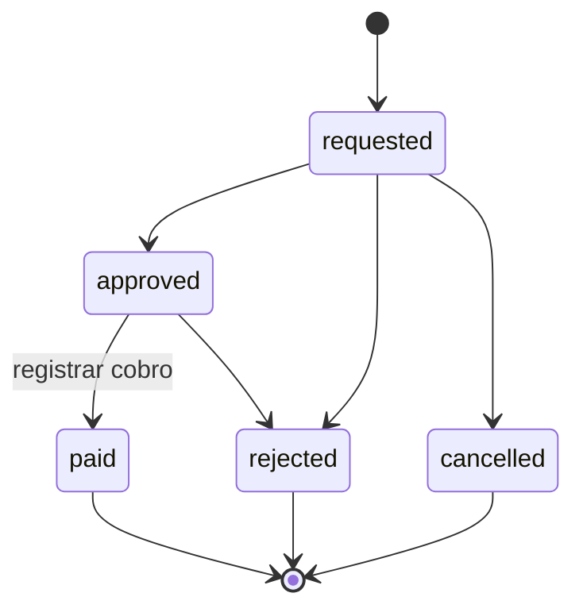

# 05 — Diseño funcional de módulos

## Mapa de módulos

| # | Módulo | Depende de |
|---|--------|------------|
| M1 | Autenticación, perfiles e invitaciones | — |
| M2 | Prop Firms (catálogo, productos, reglas versionadas) | M1 |
| M3 | Cuentas (ciclo de vida, intentos, historial) | M2 |
| M4 | Movimientos y divisas (ledger, FX) | M3 |
| M5 | Payouts | M3, M4 |
| M6 | Centro de documentos (subida, almacenamiento, vínculos) | M1 |
| M7 | Extracción inteligente (OCR/IA, revisión, duplicados) | M6, M3, M4, M5 |
| M8 | Operaciones (diario de trading, estrategias, CSV) | M3 |
| M9 | Dashboard y estadísticas | M3–M8 |
| M10 | Ajustes, exportación y eliminación de datos | todos |

---

## M2 — Prop Firms

**Pantallas:** listado de empresas (logo, divisa, nº de cuentas propias, estado de verificación de reglas) · ficha de empresa
con pestañas *Productos*, *Reglas*, *Enlaces*, *Historial de versiones*.

**Funciones:**
- Alta de empresa sin tocar código: nombre, logo, país, divisa, enlaces oficiales, alias para OCR.
- Productos: tipo de programa, tamaño nominal, precio de lista, facturación (única/mensual), plataformas.
- Reglas por fase (evaluación / funded / payout / general) desde el catálogo extensible `rule_keys`.
- Cada regla muestra una insignia: 🟢 *Verificada* (con fuente y fecha) · 🟡 *Pendiente de confirmación* · 🔴 *Desactualizada*.
- Editar reglas crea una **nueva versión**; las cuentas existentes siguen apuntando a la versión con la que se compraron.
- Aviso automático si la última revisión de reglas tiene más de 90 días.

**Estructura:** Empresa → **Línea de negocio** (futuros / CFDs…) → **Programa** (LucidFlex, The Thunder…) → **Producto** (tamaño × variante de plataforma) → **Opciones de compra** (con o sin límite diario, complemento de consistencia…) → **Versiones de reglas**.
Las reglas se asignan siempre a un producto concreto, y opcionalmente a una opción o a una ventana de fechas de compra. Las de un programa o tamaño **nunca se aplican a otro**.

**Carga inicial:** NYS Markets y Lucid Trading se cargarán con los programas y valores investigados en el **doc 10**. Ninguno está verificado:
entran como `candidate` (con URL oficial, fecha de consulta y extracto) o como `pending`. Una regla solo pasa a `verified`
con lectura directa de la fuente oficial y captura guardada. Solo las reglas `verified` se usan en cálculos y alertas.

---

## M3 — Cuentas

**Pantallas:** listado (tarjetas en móvil, tabla en escritorio) con filtros por empresa, fase, estado, producto ·
ficha de cuenta con *Resumen*, *Línea temporal* (estados + documentos), *Intentos*, *Movimientos*, *Payouts*, *Operaciones*.

**Máquina de estados** (validada por trigger en BD, no solo en la UI):

Cada transición exige: fecha efectiva, motivo (obligatorio para `burned`, `closed`, `refunded`), y admite documento justificativo.
Se registra automáticamente usuario y momento del registro.

**Evaluación → funded:** como cada empresa lo hace distinto (misma cuenta vs. cuenta nueva), se soportan ambos.
En el caso "cuenta nueva", el asistente crea la cuenta funded con `source_account_id` apuntando a la evaluación,
y la evaluación pasa a `closed` con motivo "Convertida a funded".

**Payout pendiente / recibido:** **D10 aprobada**: los payouts son entidades independientes de los estados de la cuenta.
En la cuenta se muestran solo como **insignias derivadas** ("1 payout pendiente", "3 cobrados"), porque una cuenta puede tener varios a la vez.

**Quemar una cuenta no borra nada:** la cuenta, sus intentos, movimientos, operaciones y documentos permanecen.

**Alta rápida de cuenta (formulario en 1 pantalla):** empresa → producto (rellena tamaño, divisa y precio) →
precio pagado y descuento → fecha → plataforma → ID de cuenta. Crea en una transacción: `accounts` + `transactions(purchase)` + primer `evaluation_attempt` si aplica.

---

## M4 — Movimientos y divisas

- Registro de cualquier gasto o ingreso: compra, reset, activación, renovación, datos de mercado, plataformas, herramientas, reembolsos, comisiones bancarias.
- Al elegir divisa ≠ EUR: se propone el tipo BCE del día del suceso (o último hábil anterior) mostrando fecha y fuente; el usuario puede sustituirlo por el **importe real cargado en su banco en EUR** (fuente `actual_bank`).
- Vista con columnas *Importe original* y *Equivalente EUR*, conmutables.
- Corrección = anular + nuevo registro; los anulados se ven tachados con motivo.
- **Gastos recurrentes** (suscripciones mensuales de cuentas o datos): plantilla de recurrencia que genera movimientos `pending` en su fecha; el usuario los confirma como `settled`.
- Tarea diaria (Vercel Cron) descarga tipos del BCE → `fx_rates`. Es la única escritura con `service_role` y no toca datos privados.

---

## M5 — Payouts

**Flujo:**

- **Solicitar:** cuenta, fecha, importe solicitado, divisa, método.
- **Aprobar:** fecha, importe aprobado (puede diferir del solicitado).
- **Registrar cobro:** fecha de recepción, importe efectivamente recibido y su divisa, comisiones, tipo de cambio,
  importe final en EUR (idealmente el que muestra el banco), justificante. Genera el movimiento `payout_receipt` (+ `bank_fee` si hay comisiones separadas) en la misma transacción.
- Las cuatro cifras se muestran siempre separadas: **Solicitado · Aprobado · Recibido · Neto**.
- Solo `paid` cuenta como ingreso real. Un payout rechazado no deja rastro en finanzas, sí en historial.
- Restricción única: un payout solo puede tener un movimiento de cobro no anulado.

---

## M6 — Centro de documentos

- Subida desde móvil con cámara directa (`<input type="file" accept="image/*" capture="environment">`), galería, o arrastrar en escritorio. Varias a la vez.
- Antes de subir: cálculo de SHA-256 en el cliente → si ya existe para este usuario, aviso "Este archivo ya está subido" con enlace al existente.
- Conversión HEIC→JPEG en servidor para visualizarlo; se conserva el original.
- Bandeja de entrada con estados: *Subido* · *Procesando* · *Pendiente de revisión* · *Confirmado* · *Rechazado* · *Error*.
- Un documento puede vincularse a varias entidades (p. ej., una factura con dos cuentas).
- Vista previa con URL firmada de 60 s; nunca URLs públicas.

## M7 — Extracción inteligente

**Pipeline** (diagrama de secuencia en doc 01 §5):

1. **Clasificación** del tipo de documento (`purchase_receipt`, `invoice`, `payment_confirmation`, `evaluation_passed`,
   `funded_confirmation`, `account_burned`, `trade_history`, `payout_receipt`, `rules`, `other`).
2. **Identificación de empresa** contra nombres y alias de las empresas visibles por el usuario. Si no coincide: "Empresa no reconocida" (nunca se inventa).
3. **Extracción** con JSON Schema por tipo de documento. Cada campo: `{ value, confidence, evidence }`.
4. **Emparejamiento** con cuenta: por `external_account_id` exacto; si no, candidatos por empresa+tamaño+fecha, presentados como sugerencia.
5. **Detección de duplicados** (tres niveles):
   - Archivo idéntico: `unique(owner_id, sha256)`.
   - Imagen casi idéntica (recorte/recompresión): distancia de hash perceptual baja → aviso.
   - Hecho contable repetido: mismo nº de pedido/factura/referencia (`dedupe_key`) → **bloqueo**; mismo importe+empresa±1 día → aviso que exige marcar "No es duplicado" con motivo.
6. **Pantalla de revisión:** imagen a la izquierda (zoom), campos a la derecha. Confianza baja (<0,85) o sin evidencia
   → campo vacío y resaltado, obligatorio revisar. Se muestra el texto literal que justificó cada valor.
7. **Confirmación:** una RPC transaccional crea/actualiza las entidades propuestas (movimiento, cambio de estado, payout, operaciones) y vincula el documento. Si algo falla, nada se guarda.
8. **Rechazo:** el documento queda archivado como `rejected` (o se reclasifica manualmente como "solo justificante").

**Historial de operaciones por captura:** se extraen filas candidatas a `trades`; se revisan en tabla editable antes de importar; dedupe por `external_trade_id` o por (cuenta, símbolo, apertura, cierre, cantidad, precio).

**Proveedor:** **D3 pendiente**; la comparativa está en el doc 11 §3. Va detrás de `DocumentExtractor`, con `MockExtractor` para pruebas.

---

## Prevención de duplicados (transversal, mejora obligatoria 3)

| Caso | Detección | Respuesta |
|------|-----------|-----------|
| **Captura ya procesada** (mismo archivo) | `unique(owner_id, sha256)` en `documents`, calculado en el cliente antes de subir y recomprobado en servidor | **Bloqueo**: "Ya subiste este archivo el [fecha]", con enlace al documento |
| **Captura casi idéntica** (recortada, recomprimida o reenviada por WhatsApp) | Hash perceptual (distancia de Hamming ≤ umbral) frente a los documentos del usuario | Aviso; para continuar hay que marcar "Es un documento distinto" con motivo |
| **Factura repetida** | `dedupe_key` = empresa + tipo de referencia + nº de factura normalizado → índice único | **Bloqueo** con enlace al movimiento existente |
| **Compra duplicada sin nº de factura** | `fingerprint` (empresa, tipo, importe, divisa) con fecha ±2 días | Aviso; para confirmar hace falta `duplicate_override_reason`, que queda auditado |
| **Payout contabilizado dos veces** | Índice único: un `payout_receipt` no anulado por payout · `dedupe_key` con el ID de transacción de la plataforma de pago · fingerprint importe+fecha+empresa | Bloqueo / aviso |
| **Operación importada de nuevo** | `trade_fingerprint` único + `external_trade_id` único por cuenta + sha256 del CSV | Las filas repetidas se **omiten** y se informa ("38 nuevas, 12 ya existían") |
| **Misma confirmación enviada dos veces** (doble clic, reintento de red) | `client_request_id` (UUID por envío de formulario) único en `record_changes` + bloqueo de fila del documento (`select … for update`) + estado `confirmed` | La segunda petición devuelve el resultado de la primera, sin crear nada |

**Garantía específica para la IA.** Leer dos veces el mismo justificante **nunca** genera un segundo movimiento:

1. Si es el mismo archivo, se bloquea antes de llegar a la IA (sha256).
2. Si es el mismo documento con otro archivo: la IA extrae el nº de factura, pedido o referencia, y la confirmación choca con el índice único de `dedupe_key`.
3. Si es el mismo documento confirmado dos veces: `confirm_document` comprueba `status = 'needs_review'` con bloqueo de fila, y el índice único `(document_id, document_item_key)` impide un segundo movimiento por el mismo elemento.
4. Si es una nueva extracción del mismo documento (por ejemplo, al cambiar de proveedor): crea otra fila en `document_extractions`, que es solo una propuesta, y **no toca** los movimientos ya confirmados.
5. La IA **nunca escribe** en tablas financieras: solo propone. Toda escritura pasa por la confirmación del usuario.

---

## M8 — Operaciones

- **Alta rápida** (móvil): cuenta, símbolo, dirección, entrada, salida, SL, TP, cantidad, comisiones. El sistema calcula
  bruto (si hay `point_value`), neto, riesgo inicial y R. Todos los cálculos se pueden sobrescribir con el resultado real de la plataforma (el de la plataforma manda).
- Captura del gráfico adjunta (va al centro de documentos).
- Estrategias propias y etiquetas.
- **Importación CSV (preparada, Fase posterior):** `import_batches` + mapeo de columnas por plataforma guardado como plantilla + vista previa + dedupe + deshacer importación completa (anula el lote).
- Sin conexión a plataformas para ejecutar. Sin órdenes. Solo registro y análisis.

---

## M9 — Dashboard

**Escritorio:** fila de tarjetas KPI → gráfico de evolución mensual (gasto vs. cobros, beneficio neto acumulado) →
bloques Cuentas / Conversión / Trading / Empresas.
**Móvil:** tarjetas apiladas desplazables, gráficos simplificados, botón flotante **"+"** (Nueva compra · Nuevo payout · Nueva operación · Subir captura).

**Filtros globales** (persisten en la URL): rango de fechas (este mes, 3/6/12 meses, año, todo, personalizado),
empresa, tipo de cuenta/producto, estado. El filtro de "usuario" no existe como selector: cada uno solo ve lo suyo.

Cada KPI tiene un icono ⓘ con su fórmula y denominador (doc 06) y permite "ver detalle" (lista de registros que lo componen) — clave para auditar.

Separación visual obligatoria:
- **Finanzas reales (EUR)**: dinero que sale y entra de tu bolsillo.
- **Trading (capital nominal, divisa de la cuenta)**: P&L en cuentas de la empresa, no es dinero tuyo hasta que hay payout.

---

## M10 — Ajustes, exportación y datos

Perfil, divisa base (EUR por defecto), zona horaria, MFA, sesiones activas, texto de privacidad (D4) y eliminación de cuenta (proceso explícito, D11 pendiente).
Solo `platform_owner`: invitaciones y catálogo global de empresas.

### Exportación de datos (mejora obligatoria 2)

Cada usuario exporta **exclusivamente sus propios datos**:

| Conjunto | CSV | Excel (.xlsx) | Contenido |
|----------|-----|---------------|-----------|
| Movimientos | ✔ | ✔ | Todos los campos, incluido el importe original, la divisa, el tipo de cambio, la fecha y fuente del cambio, el importe en EUR, el estado (anulado/rectificado) y la referencia de rectificación |
| Cuentas | ✔ | ✔ | Cuenta, empresa, programa, producto, opciones, estado, fechas, historial de estados (hoja aparte en Excel) |
| Operaciones | ✔ | ✔ | Todas, con R, estrategia y lote de importación; las anuladas van marcadas |
| Payouts | ✔ | ✔ | Las 4 cifras, estados, fechas, comisiones, EUR final, historial de estados |
| Historial de cambios | ✔ | ✔ (hoja) | `record_changes` del usuario |
| Documentos | — | — | ZIP con los originales organizados por carpeta y tipo, más un `manifest.csv` (id, tipo, fecha, sha256, entidades vinculadas) |
| Archivo completo | — | — | ZIP con todo lo anterior + JSON legible por máquina |

- Filtros opcionales: rango de fechas y empresa. Las anuladas se incluyen por defecto, con una columna de estado.
- Excel: una hoja por conjunto, cabeceras en español, números como números (no texto), formato `es-ES`, importes con 2 decimales y fechas reales de Excel.
- Generación en servidor **con el JWT del usuario** (RLS aplica): una exportación nunca puede contener filas de otro `owner_id`, aunque falle el filtro de la aplicación.
- Las exportaciones grandes se generan como trabajo (`export_jobs`), se guardan en `uid/exports/`, se descargan por URL firmada de 60 s y **se borran a las 24 h**.
- Protección contra inyección de fórmulas en CSV/Excel: toda celda de texto que empiece por `=`, `+`, `-` o `@` se escapa. Importa porque los datos pueden venir del OCR de una captura.
- Cada exportación queda en `audit_log` (quién, cuándo, qué conjuntos).

---

## Diseño UX/UI

**Identidad visual (tokens):**

| Token | Valor orientativo | Uso |
|-------|-------------------|-----|
| `--bg` | `#0B0A12` | Fondo |
| `--surface` | `#14121F` | Tarjetas |
| `--surface-2` | `#1C1930` | Elevación / hover |
| `--border` | `#2A2540` | Bordes sutiles |
| `--primary` | `#7C3AED` (violet-600) | Acción principal |
| `--primary-soft` | `#A78BFA` (violet-400) | Acentos, gráficos |
| `--accent` | `#C026D3` (fuchsia-600) | Detalles puntuales |
| `--text` / `--muted` | `#EDEBF5` / `#9C97B3` | Texto |
| `--positive` / `--negative` / `--warning` | `#22C55E` / `#F43F5E` / `#F59E0B` | Ganancia / pérdida / pendiente |

- Tipografía: Inter (o Geist) con cifras tabulares (`font-variant-numeric: tabular-nums`) en todos los importes.
- Contraste AA verificado para texto sobre `--surface`. Nunca usar solo color para ganancia/pérdida: también signo e icono.
- Navegación: barra lateral en escritorio (Dashboard, Cuentas, Payouts, Operaciones, Movimientos, Documentos, Empresas, Ajustes); barra inferior en móvil con 4 destinos + botón central de captura.
- Formularios: valores por defecto inteligentes (fecha de hoy, última empresa usada, divisa del producto), teclado numérico en móvil, validación en línea, guardado en < 3 toques para lo frecuente.
- Estados vacíos que enseñan ("Aún no tienes cuentas. Añade tu primera compra o sube una captura").
- PWA instalable (icono en pantalla de inicio), sin modo offline para datos financieros en la primera versión (evita conflictos de sincronización).
- Nada recargado: máximo 4 KPIs destacados por bloque, el resto en "ver más".
